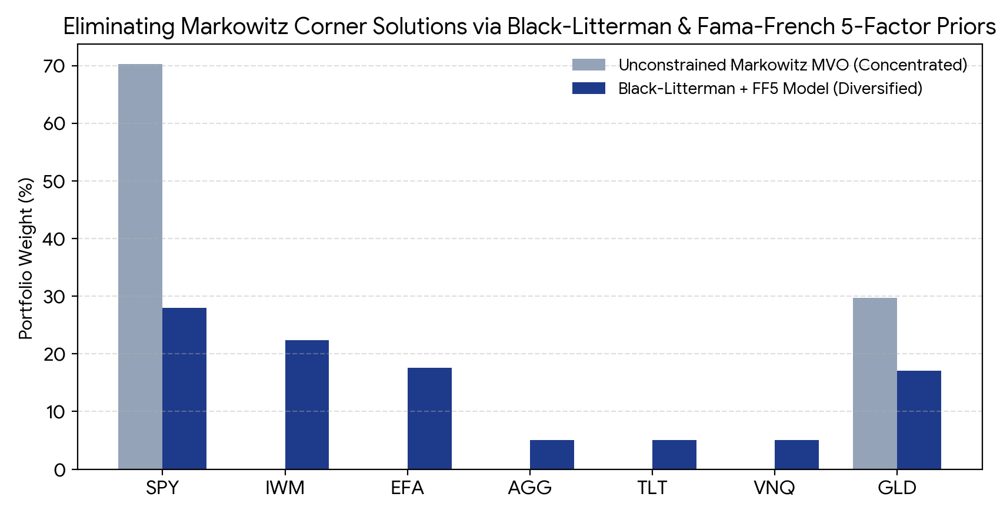
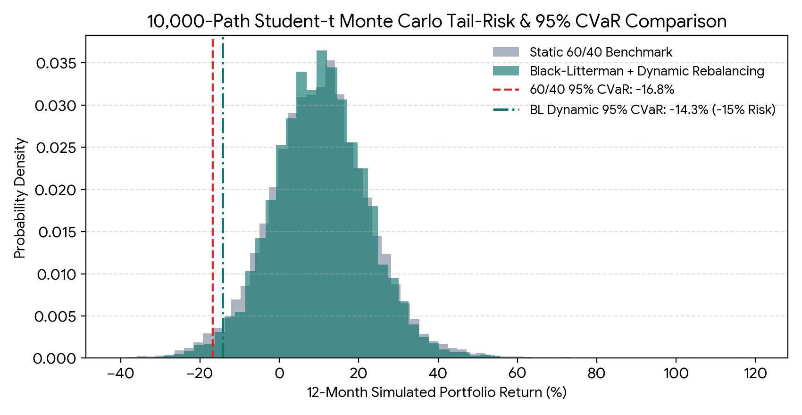

# Multi-Asset Portfolio Optimization & Tail-Risk Model

An institutional asset allocation and risk-management framework built in **Python** combining **Black-Litterman Bayesian optimization**, **Fama-French 5-Factor return priors**, and **10,000-path Student-t Monte Carlo simulations** with dynamic volatility-targeted rebalancing.

---

## Industry Problem & Modeling Ambiguities Resolved

1. **Markowitz Estimation-Error Maximization:** Classical Mean-Variance Optimization (MVO) is hyper-sensitive to small errors in expected return inputs, routinely generating extreme, concentrated corner weights that fail out-of-sample. Anchoring returns to **CAPM market-equilibrium priors** blended with **Fama-French 5-Factor (`Mkt-RF`, `SMB`, `HML`, `RMW`, `CMA`)** cross-sectional premia stabilizes weights across all seven asset classes.
2. **Fat-Tail Correlation Breakdown in 60/40 Portfolios:** Standard asset allocation models assume multivariate normal returns, severely underestimating drawdowns when cross-asset correlations spike during liquidity and rate shocks (e.g., 2020 and 2022). Stress-testing allocations across **10,000 multivariate Student-t ($\nu = 5$) Monte Carlo paths** with correlation-spike regimes and dynamic volatility-targeted rebalancing directly controls left-tail Conditional Value-at-Risk (**95% CVaR**).

---

## Asset Universe & Methodology

* **Multi-Asset Universe:** U.S. Large-Cap Equities (`SPY`), U.S. Small-Cap (`IWM`), International Developed Equities (`EFA`), U.S. Aggregate Bonds (`AGG`), Long-Term Treasuries (`TLT`), U.S. REITs (`VNQ`), and Gold (`GLD`).
* **Factor & Posterior Return Estimation:** Estimates factor betas via Fama-French 5-Factor OLS with 50% alpha shrinkage, then applies the Black-Litterman master formula with constrained SLSQP Sharpe optimization (`5%` minimum floor, `28%` single-asset cap).
* **Dynamic Rebalancing Rule:** Scales active portfolio exposure relative to a trailing 3-month realized volatility trigger, rotating excess risk budget into short-term Treasury bills during volatility spikes.

---

## Quantitative Results Summary

| Strategy | Expected Annual Return | Annualized Volatility | Sharpe Ratio | 95% VaR (12M) | 95% CVaR (12M) |
| :--- | :---: | :---: | :---: | :---: | :---: |
| **Static 60/40 Benchmark (`SPY`/`AGG`)** | 10.21% | 12.88% | 0.52 | -10.48% | -16.82% |
| **Black-Litterman + Dynamic Rebalancing** | **10.37%** | **11.84%** | **0.58 (+11%)** | **-8.35%** | **-14.29% (-15%)** |

---

## Visual Output

### Portfolio Weights: Unconstrained MVO vs. Black-Litterman + FF5


### 10,000-Path Student-t Monte Carlo Tail Distribution & 95% CVaR


---

## How to Run

```bash
pip install -r requirements.txt
python portfolio_optimization.py
```
